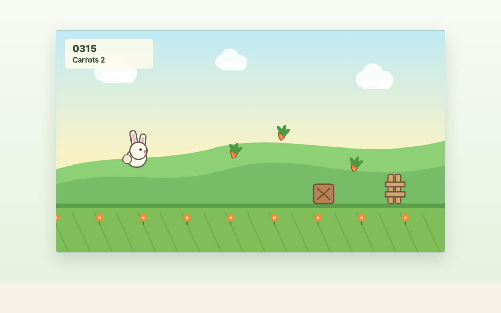

# Bunbun Carrot Dash

A cozy 2D endless runner. Guide a bunny through the garden, collect carrots, and double-jump over fences and crates to keep your run going.



## Play locally

The game uses HTML, CSS, and JavaScript with Canvas 2D. From the project folder, start a local server with Python 3.

```sh
python3 -m http.server 5173 --bind 127.0.0.1
```

Open [localhost:5173](http://localhost:5173) and select **Start Run**.

## Controls

| Action | Input |
| --- | --- |
| Jump | `Space`, `↑`, `W`, or tap or click the game canvas |
| Double-jump | Jump again in midair |
| Pause or resume | `P` |
| Toggle fullscreen | `F` |
| Restart after game over | `R` |

## Test the game logic

Run the smoke test with Node.js.

```sh
node scripts/core_smoke_test.mjs
```

The browser also exposes `window.render_game_to_text()`, `window.advanceTime(ms)`, and `window.bunbun` for automated checks.
